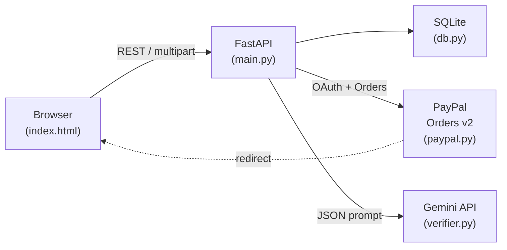

# ProofPay

> **Money is held by PayPal and released only when AI verifies the work was done.**

ProofPay is a conditional-payment escrow platform. A payer funds a milestone via PayPal (authorization hold), the freelancer submits proof of delivery, and Gemini AI evaluates that proof against explicit criteria. Only a verified "pass" releases the funds — a "fail" voids the authorization (refund), and "unclear" escalates to manual review.

---

## Architecture



---

## How PayPal is used

| Step | PayPal call | Effect |
|------|-------------|--------|
| Create milestone | `POST /v2/checkout/orders` (intent=**AUTHORIZE**) | Generates a buyer-approval URL; no money moves yet |
| Buyer approves | PayPal redirect → `/api/milestones/{id}/authorize` | `POST /v2/checkout/orders/{order}/authorize` — funds placed on hold |
| AI passes | Automatically: `POST /v2/payments/authorizations/{id}/capture` | Money released to seller |
| AI fails | Automatically: `POST /v2/payments/authorizations/{id}/void` | Hold cancelled, money returned to buyer |
| Manual release | `/decide {action:release}` → capture | Human override for "unclear" cases |
| Manual refund | `/decide {action:refund}` → void | Human override for "unclear" cases |

---

## How AI is used

The verifier (`verifier.py`) sends a **structured Gemini JSON-mode prompt** that:

1. Treats proof content as **untrusted data** (prompt-injection resistant via strict delimiters).
2. Splits the milestone criteria into individual checkable items.
3. Returns a typed JSON schema: `{verdict, confidence, reasons, criteria_checks}`.
4. Falls back to a **deterministic keyword mock** (`MOCK_AI=1`) when Gemini is unavailable — clearly flagged in the UI with a "demo fallback" badge.

---

## Local setup

### Prerequisites
- Python 3.11+
- A PayPal Developer sandbox account (optional — demo mode works without it)
- A Gemini API key (optional — set `MOCK_AI=1` to skip)

### Steps

```bash
# 1. Clone and enter the project
cd proofpay

# 2. Create a virtual environment
python -m venv venv
source venv/bin/activate      # Windows: venv\Scripts\activate

# 3. Install dependencies
pip install -r requirements.txt

# 4. Configure environment
cp .env.example .env
# Edit .env with your credentials (see "Environment variables" below)

# 5. Run (demo/mock mode — no credentials needed)
MOCK_AI=1 uvicorn main:app --reload

# 6. Open in browser
open http://localhost:8000
```

### Quick smoke test (all with mock AI)

```bash
# In a separate terminal after starting the server with MOCK_AI=1:

# Health check
curl -s http://localhost:8000/api/health | python -m json.tool

# Create a milestone (demo mode — no PayPal creds needed)
MILESTONE=$(curl -s -X POST http://localhost:8000/api/milestones \
  -H "Content-Type: application/json" \
  -d '{"title":"Test milestone","amount":100,"criteria":"Deliver complete source code\nAll tests pass\nDocumentation updated","template":"freelance"}' \
  | python -m json.tool | grep '"id"' | head -1 | tr -d ' "id:,')
echo "Created: $MILESTONE"

# List milestones
curl -s http://localhost:8000/api/milestones | python -m json.tool

# Submit a passing proof (use the ID from above)
curl -s -X POST http://localhost:8000/api/milestones/$MILESTONE/proof \
  -F "text=All deliverables are completed and submitted. Source code delivered, all tests pass and are documented." \
  | python -m json.tool
```

### Seed demo data

```bash
MOCK_AI=1 python scripts/seed_demo.py
```

This creates 3 milestones with pre-verified proofs (pass / fail / unclear) visible in the ledger.

---

## Environment variables

| Variable | Required | Default | Description |
|----------|----------|---------|-------------|
| `PAYPAL_CLIENT_ID` | For real payments | — | PayPal sandbox/live app client ID |
| `PAYPAL_SECRET` | For real payments | — | PayPal sandbox/live app secret |
| `PAYPAL_BASE` | No | `https://api-m.sandbox.paypal.com` | PayPal API base URL |
| `GEMINI_API_KEY` | For real AI | — | Google Gemini API key |
| `GEMINI_MODEL` | No | `gemini-3.5-flash-lite` | Gemini model name |
| `BASE_URL` | No | `http://localhost:8000` | Your app's public URL (for PayPal redirect URLs) |
| `MOCK_AI` | No | `0` | Set to `1` for deterministic mock AI (no Gemini call) |
| `DB_PATH` | No | `proofpay.db` | SQLite file path |

---

## PayPal sandbox setup

1. Go to [developer.paypal.com](https://developer.paypal.com/developer/applications) → **My Apps & Credentials**
2. Create a **Sandbox** app → copy **Client ID** and **Secret** into `.env`
3. Under **Sandbox → Accounts**, find the auto-created buyer account (personal)
4. Note the buyer's email and password — use these when PayPal redirects you to approve payment
5. Set `PAYPAL_BASE=https://api-m.sandbox.paypal.com` (already the default)

### Fund a milestone end-to-end

```
1. Create milestone on ProofPay  →  approve_url returned
2. Open approve_url in browser  →  PayPal sandbox login
3. Log in as the sandbox buyer and approve
4. PayPal redirects to /?funded={id}&token={order_id}
5. ProofPay auto-authorizes and sets status → HELD
6. Submit proof  →  AI verifies  →  RELEASED / VOIDED / NEEDS_REVIEW
```

---

## Deploy to Render

1. Push this repo to GitHub
2. Go to [render.com](https://render.com) → **New Web Service** → connect repo
3. Render picks up `render.yaml` automatically
4. Set the secret env vars in the Render dashboard:
   - `PAYPAL_CLIENT_ID`, `PAYPAL_SECRET`, `GEMINI_API_KEY`
   - `BASE_URL` = `https://your-service.onrender.com`
5. Deploy — Render installs deps and starts uvicorn

---

## Decisions

- **SQLite over PostgreSQL**: Zero-config, no external service needed for a hackathon or Render free tier. Swappable via SQLAlchemy if needed later.
- **No ORM**: Raw `sqlite3` stdlib keeps the dependency footprint minimal and the query intent explicit.
- **Short milestone IDs**: 8-char UUID prefix keeps URLs readable; collision probability is negligible at hackathon scale.
- **In-memory token cache**: PayPal access tokens are cached per-process (not per-request) to avoid hammering the OAuth endpoint. Redis would be used in multi-worker production.
- **Popup for PayPal approval**: Avoids full-page navigation; falls back gracefully if the browser blocks popups.
- **Prompt injection defence**: Proof text is injected into the Gemini prompt inside a clearly labelled `---UNTRUSTED DATA---` block with an explicit instruction to ignore any directives therein. The response schema enforces structured output only.
- **Graceful degradation**: If PayPal creds are missing, the app runs in demo mode (simulated payment steps) with a visible warning. If Gemini is unavailable, the keyword mock runs and flags `"mock": true` in the AI result, surfaced as a "demo fallback" badge in the UI.
- **`final_capture: true`**: Each milestone has a single capture, so we always set `final_capture` to prevent accidental re-capture and simplify the payment lifecycle.
- **CORS `allow_origins=["*"]`**: Acceptable for a sandbox/hackathon; restrict to your domain in production.
- **Vanilla JS / single HTML file**: No build step, no bundler, instant iteration. Matches the SPEC requirement and keeps deployment trivially simple.

---

## Tools used

- **FastAPI** — async Python web framework
- **SQLite** (stdlib) — embedded relational database
- **httpx** — async HTTP client for PayPal and Gemini API calls
- **PayPal Orders v2 API** — authorize/capture/void payment flow
- **Google Gemini API** — vision-capable LLM for proof verification, JSON response mode
- **Uvicorn** — ASGI server
- **Inter** (Google Fonts) — UI typography
- **Render** — cloud deployment

---

## License

MIT © 2026 ProofPay Contributors
